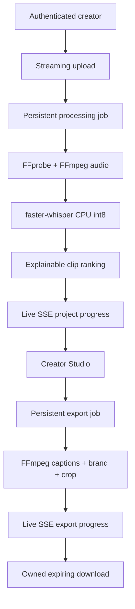

# Architecture

## Connected launch flow



The cost boundary remains deliberate: transcript ranking can suggest eight moments without rendering eight MP4s. Rendering starts only after the creator chooses a moment.

## Modules

```text
frontend/app/            15 responsive product routes
frontend/components/     auth, shell, upload/realtime experiences
frontend/lib/            typed API client
backend/app/api/         authenticated HTTP and SSE contract
backend/app/core/        configuration and WAL-mode SQLite
backend/app/services/    auth, jobs, transcription, ranking, rendering, cleanup
backend/tests/           unit and connected API tests
backend/storage/         expiring source and export files
```

## Data ownership

Every project query joins through `projects.user_id`. Clips are authorized through video → project → user. Exports also store `user_id` and downloads require the session cookie. Account A receives 404—not metadata—for Account B's project.

## Realtime contract

Jobs store `queued | processing | completed | failed`, a percentage, stage, human message, error, and project/export reference. `/jobs/{id}/events` emits state changes through SSE and stops on a terminal state. Since the job state is persistent, a page can recover through `/jobs/{id}` even when the live connection is interrupted.

## Single-node launch vs scale

| Concern | Included launch mode | Scale target |
|---|---|---|
| API | FastAPI + Uvicorn | Multiple stateless replicas |
| Database | SQLite WAL | PostgreSQL |
| Jobs | Background task + persistent record | Redis + Celery/Dramatiq workers |
| Media | Expiring local volume | Cloudflare R2/S3 signed objects |
| Transcription | faster-whisper CPU int8 | Dedicated CPU/GPU pool |
| Realtime | SSE from API | SSE gateway reading Redis events |
| Billing | Signed Razorpay webhook | Same contract + subscription service |
| Cleanup | Hourly in-process loop | Scheduled worker/lifecycle policies |

The source laptop can run `tiny` Whisper and one render at a time. Production should separate API responsiveness from CPU-heavy media workers.
